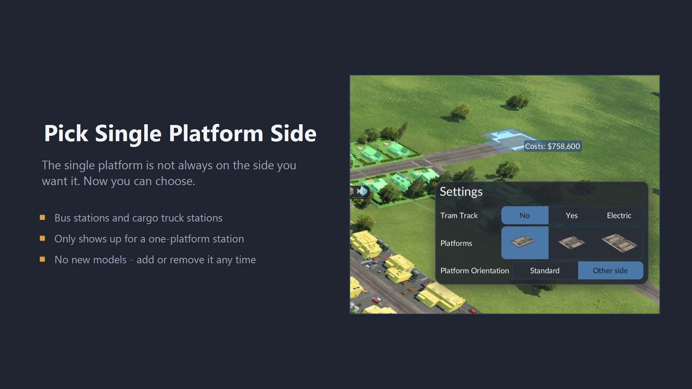

# Pick Single Platform Side

A mod for **Transport Fever 3**. When placing a bus station or a cargo truck
station you can select one, two or four platforms. Two and four are symmetric,
but the single platform always lands on the same side of the entrance - which is
sometimes the wrong side for the spot you are building on.

This mod adds a **Platform Orientation** option to the placement dialog, next to
the platform count. Pick **Other side** and the lone platform moves across the
entrance.

Published on mod.io. No new models, textures or icons, and no base game file is
replaced.

**Playing?** [PLAYERS.md](PLAYERS.md) - what the option does, why it is not
labelled left and right, and what it means for your savegames.

**Modding?** [MODDERS.md](MODDERS.md) - the one mirror the whole mod consists
of, how it is hooked in, and how to build it.

## The rest of the documentation

- [NOTES.md](NOTES.md) - what the install says and why this works at all.
- [PLAN.md](PLAN.md) - the implementation and test plan.
- [../NOTES.md](../NOTES.md) - the engine-general findings this builds on.
- [../README.md](../README.md) - the repository: the other mod, the shared
  tools, and where a given piece of documentation belongs.
